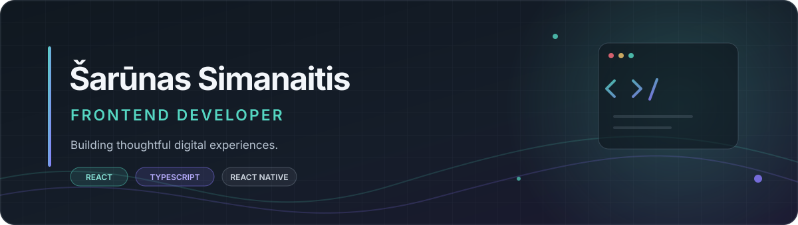

<!--
  Šarūnas Simanaitis — GitHub profile
  Dark editorial style with a little colour and personality.
-->

<div align="center">



<br />

<a href="https://sarunas-simanaitis-portfolio.vercel.app/">
  
</a>
<a href="https://www.linkedin.com/in/%C5%A1ar%C5%ABnassimanaitis/">
  
</a>

</div>

---

## A little about me

I'm a frontend developer who enjoys turning ideas into useful, well-crafted digital products.

I care about the details that make software feel good to use: clear interfaces, thoughtful interactions, maintainable code and performance. I enjoy learning by building, getting hands-on with problems and improving a product through iteration.

- **Currently focused on:** React, TypeScript and modern frontend development
- **Also exploring:** React Native, Expo and mobile app development
- **Based in:** Poland
- **Portfolio:** [sarunas-simanaitis-portfolio.vercel.app](https://sarunas-simanaitis-portfolio.vercel.app/)

## Selected work

<div align="center">

<a href="https://github.com/SarunasSimanaitis/frictionless-notes">
  
</a>
<a href="https://github.com/SarunasSimanaitis/MoosclesPro">
  
</a>
<a href="https://github.com/SarunasSimanaitis/sarunas-simanaitis-portfolio">
  
</a>
<a href="https://github.com/SarunasSimanaitis/Student-Registration-System">
  
</a>

</div>

## Tools I work with

<div align="center">


</div>

## What I'm about

```ts
const developer = {
  mindset: ["Curious", "Practical", "Always learning"],
  priorities: ["Usability", "Clean code", "Thoughtful details"],
  learningBy: "Building real projects",
};
```

---

<div align="center">

**Have an interesting project or opportunity? Let's talk.**

<a href="https://sarunas-simanaitis-portfolio.vercel.app/">Portfolio</a>
&nbsp; · &nbsp;
<a href="https://www.linkedin.com/in/sarunassimanaitis">LinkedIn</a>

<sub>Designed with care · Built one project at a time</sub>

</div>
